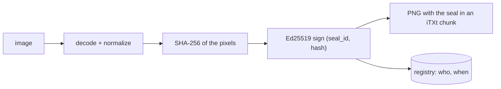

# MiniSeal

[](https://github.com/Naama-K/miniseal/actions/workflows/ci.yml)

**Prove a photo is yours, and that nobody has changed it.**

Publishers seal their images when they publish them. Anyone can later upload a
copy and learn whether it's **intact**, **tampered** (and why) or **unsealed**,
and who sealed it and when. Every check also includes a score estimating
whether the image looks generated or edited.

## Quick start

```bash
docker compose up --build
```

Open **http://localhost:8000**: create an account, seal an image, then verify it.
The *Try it* buttons show what happens when someone edits one pixel (tampered)
or re-saves the image the way social apps do (unsealed). API docs: `/docs`.

The first start creates a signing key inside the data volume; seals, API keys
and that key all live in the `miniseal_miniseal-data` volume. **Back up the
volume**: losing it means every existing seal reads as `unknown_key`.

## API

| Method | Path | Auth | What it does |
|---|---|---|---|
| `POST` | `/seal` | API key | Image in (PNG, JPEG, WebP, ...), sealed PNG out. Seal id and detector verdict in `X-Miniseal-*` headers |
| `POST` | `/verify` | none | `sealed_intact` / `sealed_tampered` (+ reason) / `unsealed`, plus the detector result |
| `GET` | `/seals` | API key | Your own seals, newest first |
| `GET` | `/seals/{id}` | API key | When and by whom; yours only (others get 404) |
| `POST` | `/signup` | none | Self-service API key, when `MINISEAL_OPEN_SIGNUP=true` |
| `GET` | `/me` | API key | Who the key belongs to |
| `GET` | `/health` | none | Liveness |
| `GET` | `/ready` | none | Readiness: signing key loaded, database reachable |

```bash
curl -H "X-API-Key: $KEY" -F file=@photo.jpg -o photo.sealed.png -D - http://localhost:8000/seal
curl -F file=@photo.sealed.png http://localhost:8000/verify
```

Errors: `400` not an image, `401` missing or invalid key, `409` already sealed,
`413` too large (bytes or pixels), `422` refused by the seal policy, `503` not configured.

## How it works



- **The pixels are hashed, not the file.** Embedding the seal changes the file's
  bytes, so a file hash would break itself. A pixel hash survives lossless
  re-encoding and changes if a single pixel does.
- **The seal_id is signed together with the hash,** so a genuine seal can't be
  moved onto another record to borrow its owner.
- **The output is always PNG.** Lossless: a JPEG would change the pixels and every
  honest image would fail.
- **Verification trusts nothing in the file** until it's proven, checking in
  order: malformed seal, unknown key, invalid signature, unknown seal, registry
  mismatch, pixels modified.
- **The detector can never override or hide the seal result.** It returns a score; the
  threshold is a setting (`MINISEAL_DETECTOR_THRESHOLD`). A publisher can choose
  `MINISEAL_SEAL_POLICY=reject_suspicious` to refuse sealing likely fakes.
  The current model is a deterministic placeholder behind a `Detector` interface.
- **Every detector run is logged** (at sealing and at every verification) for
  model quality, latency and usage analysis.

| Module | Responsibility |
|---|---|
| `app/crypto.py` | Pixel hash, seal message, Ed25519 signer |
| `app/embed.py` | Decode, prepare, write and read the PNG seal |
| `app/seal.py`, `app/verify.py` | The seal pipeline and the verification checks |
| `app/detector.py` | Detector interface, placeholder model, timing |
| `app/store.py`, `app/auth.py` | SQLite registry, detection log, API keys |
| `app/main.py` | HTTP routes |
| `app/static/` | The web app |

## Security

- **API keys:** 256-bit, shown once, stored only as SHA-256 hashes, revocable
  immediately. Missing, wrong and revoked keys get the same 401.
- **Privacy between customers:** you only ever see your own seals; someone else's
  seal id returns the same 404 as one that doesn't exist.
- **Signing key:** never leaves the server. Revoking an API key doesn't
  invalidate seals made with it.
- **Uploads:** byte and pixel limits (decompression bombs) are checked before decoding.
- **Web app:** a strict Content-Security-Policy, and no third-party code.
- **Container:** non-root, read-only filesystem, no Linux capabilities.

## Operating it

```bash
docker compose exec miniseal python -m app.auth create <owner>   # issue a key (printed once)
docker compose exec miniseal python -m app.auth list
docker compose exec miniseal python -m app.auth revoke <id>
```

| Setting | Default | |
|---|---|---|
| `MINISEAL_SIGNING_KEY` / `_FILE` | generated in the volume | Ed25519 key (base64). Set one, not both |
| `MINISEAL_DB_PATH` | `/data/miniseal.db` in Docker | SQLite file |
| `MINISEAL_OPEN_SIGNUP` | `false` (`true` in compose) | Self-service sign-up |
| `MINISEAL_SEAL_POLICY` | `always` | or `reject_suspicious` |
| `MINISEAL_DETECTOR_THRESHOLD` | `0.5` | Score at which an image is "suspicious" |
| `MINISEAL_MAX_UPLOAD_BYTES` / `_MAX_IMAGE_PIXELS` | 10 MB / 40 MP | Upload limits |

Run a single instance: the registry is one SQLite file on one volume. More
throughput on one machine: more uvicorn workers. High availability means moving
the registry to Postgres and the signing key to a secrets manager, then running
several stateless instances behind a load balancer that routes on `/ready`.

## Known limits

- **Stripping metadata removes the seal.** Messaging apps and screenshots drop it
  and the image reads as *unsealed*, never as *intact*: a seal can be removed
  but not forged.
- **Recompressed copies no longer match** the exact pixel hash.
- **The signing key** is stored in the data volume, not a KMS or HSM, and there's no
  key rotation yet.
- **The detection log is written synchronously**, so a database held by another
  writer can delay `/verify` by up to 5 seconds.

## Roadmap

1. Seal revocation ("published by mistake"), recording which API key made each seal
2. Per-key rate limits and usage metering
3. A perceptual-hash match: "derived from a sealed original"
4. A pixel watermark carrying the seal id, which survives metadata stripping
5. Postgres for the registry and a log pipeline for analytics

## Development

```bash
python -m venv .venv && .venv/bin/pip install -r requirements-dev.txt   # Windows: .venv\Scripts\pip
cp .env.example .env    # then set MINISEAL_SIGNING_KEY to the output of: python -m app.crypto
uvicorn app.main:app --reload
```

```bash
pytest -m "not integration"   # fast suite (~10 s)
pytest                        # + integration tests against a real server (~2 min)
ruff check . && ruff format --check . && mypy
python scripts/smoke_test.py http://localhost:8000
```

CI runs all of this on Ubuntu and Windows for every pull request, plus a Docker
build with a smoke test, `pip-audit` and a secret scan.
